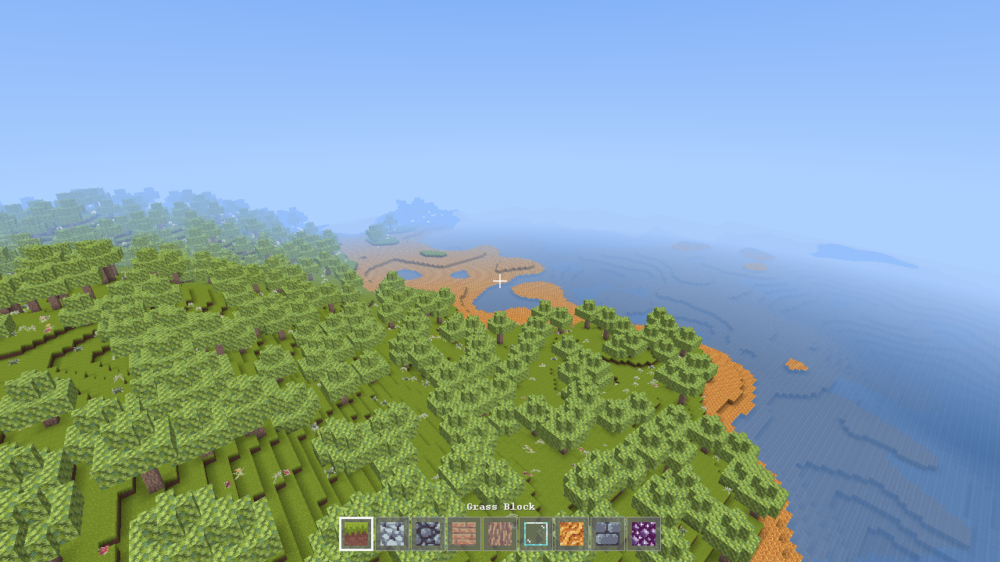

# Craft

A small, local Minecraft. Generate a world, walk around it, mine blocks, build things — all
saved to files in this folder. No database, no server, no account.



## Running it

Double-click **`run.bat`**.

The first run downloads about 15 MB of libraries into `libs/` and compiles the source into
`out/`; after that the project is entirely offline. You need a JDK 17 or newer on your PATH —
nothing else. No Maven, no Gradle, no installer.

To rebuild after changing the code, run `build.ps1` (or just `run.bat` again after deleting
`out/`).

### Why not an applet?

Java applets were deprecated in Java 9 and the `java.applet` API and browser plugin were
removed outright, so there is no applet to target on a modern JDK. `run.bat` launches a normal
desktop window instead — same experience, and it can actually use the GPU.

## Controls

| | |
|---|---|
| **W A S D** | walk |
| **Space** | jump — double-tap to fly (creative only) |
| **Shift** | sneak, or descend while flying |
| **Ctrl**, or double-tap **W** | sprint |
| **Mouse** | look |
| **Left click** | mine — hold until the block breaks |
| **Right click** | place the selected block |
| **Middle click** | pick the block you are looking at |
| **1**–**9**, scroll wheel | choose a hotbar slot |
| **E** | inventory — click a block to put it in the selected slot |
| **F2** | screenshot, into `screenshots/` |
| **F3** | debug overlay |
| **F4** | switch between Survival and Creative |
| **Esc** | pause; from the pause menu, save and return to the world list |

## The two modes

**Survival** starts you with a small kit of blocks. Blocks take time to mine and go into your
inventory when they break. Falling more than three blocks hurts, and staying underwater
drowns you. Health regenerates slowly when you are not being injured.

**Creative** gives you every block in the game, instant mining, and flight on a double-tap of
space. Nothing can hurt you.

`F4` switches between them at any time, in any world.

*One deliberate simplification:* there are no dropped-item entities. A block you mine goes
straight into your inventory rather than popping out as a collectable. It is the one visible
departure from Minecraft's behaviour.

## What the world is made of

Terrain comes from layered Perlin noise: a broad continent field decides where land and sea
are, hills add local relief, and a separate mask decides where mountain ridges are allowed so
they cluster into ranges instead of covering everything evenly. Nine biomes — ocean, beach,
plains, forest, birch forest, desert, snowy plains, mountains and snowy peaks — are chosen from
temperature, humidity and altitude, which is why snow appears on high peaks even in warm
regions.

Underground, tunnels are carved where two independent noise fields are both near zero. A single
near-zero band would carve broad *sheets* through the rock; intersecting two of them leaves
their line of intersection, which is an actual winding passage. Ore veins are thresholded 3D
noise rather than per-block dice rolls, so they come out as connected pockets.

Lighting is a flood fill in two channels. Sunlight falls from the sky and keeps full strength
straight down through clear air — that is what makes a mine shaft stay bright all the way to
the bottom — while spreading sideways one level at a time. Block light from glowing blocks like
amethyst is tracked separately, so nightfall dims the daylight without putting out your lamps.
On top of that, each vertex is darkened by the blocks meeting at its corner, which is what
gives the terrain its depth.

## How worlds are saved

Everything lives in `saves/<world name>/`:

```
saves/Hillside/
  level.json              seed, mode, time of day, player, inventory
  chunks/c.3.-7.dat       one gzipped file per chunk you have edited
```

`level.json` is plain text and safe to read or hand-edit.

**Only chunks you have actually changed are written.** Terrain is a pure function of the seed,
so an untouched chunk can be regenerated byte for byte and storing it would be dead weight. A
world you have explored for an hour but not built in is a single small file. This is also why
`check.bat` tests generation determinism so carefully: if generation were not perfectly
reproducible, reloading would silently rearrange the parts of the world you had not touched.

Worlds autosave every 30 seconds, when chunks scroll out of range, and on exit.

## Checking it still works

```
check.bat
```

Runs headless checks over world generation, collision and movement, lighting, and save/load —
about thirty assertions, no window required. They have already earned their keep: they caught
both an fBm normalisation bug that had flattened the entire world into a 30-block height range,
and a collision bug that launched the player a block into the air whenever they walked into a
wall.

The rendering can only really be checked by looking at it, so `run.bat` remains the test for
that.

## Command line

Mostly useful for development:

```
java -cp "libs/*;out" com.craft.Main [options]

  --seed=<number|text>       world seed; text is hashed
  --world=<name>             skip the menu and open (or create) that world
  --mode=survival|creative
  --render-distance=<2..24>  default 8
  --time=<0..1>              freeze the clock; 0 dawn, 0.25 noon, 0.75 midnight
  --debug                    start with the F3 overlay on
  --camera=x,y,z,yaw,pitch   place the camera for a repeatable shot
  --screenshot=<path>        wait for the world to load, save a PNG, exit
  --exit-after=<seconds>     close cleanly after a while, saving on the way out
```

## Performance

Steady state is 60 fps at render distance 12 on integrated graphics (AMD Radeon, OpenGL 3.3),
drawing about 520,000 triangles. The default distance of 8 leaves plenty of headroom. If your
machine struggles, lower `--render-distance`; the frame rate you see while a world is first
loading is not representative, as it is dominated by one-off generation and lighting work.

## How the code is laid out

```
src/com/craft/
  Main, Game          entry point and the frame loop
  core/               window, input, timing
  world/              blocks, chunks, terrain generation, lighting, sky
  mesh/               turning chunks into vertex data
  render/             shaders, textures, chunk and HUD drawing
  entity/             player physics, collision, crosshair raycast
  game/               inventory, breaking and placing, survival rules
  save/               JSON, world storage
  ui/                 menus
  dev/                the headless self-checks
assets/
  shaders/            GLSL, loaded at runtime so you can edit without rebuilding
  textures/blocks/    the block texture pack
```

Shaders are read from disk at startup, so you can change one and relaunch without recompiling.

## Third-party work

Built on [LWJGL 3](https://www.lwjgl.org/) (BSD-3) for windowing, OpenGL and OpenAL, and
[JOML](https://github.com/JOML-CI/JOML) (MIT) for the maths. Block textures are a CC0 pack —
see [ASSET-LICENSES.md](ASSET-LICENSES.md). The font is rendered from a JDK logical font at
startup, and every sound is synthesised in code, so there are no font or audio files at all.

No Minecraft code or artwork is used anywhere in this project. Minecraft is a trademark of
Mojang Studios; this is an independent piece of work that is not affiliated with or endorsed
by them.
